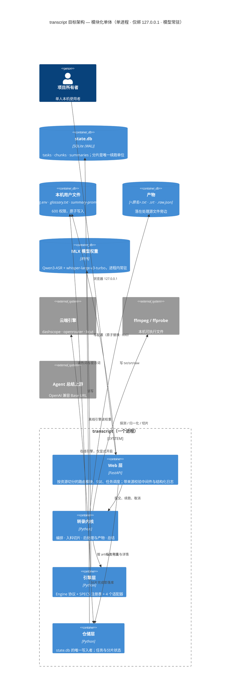
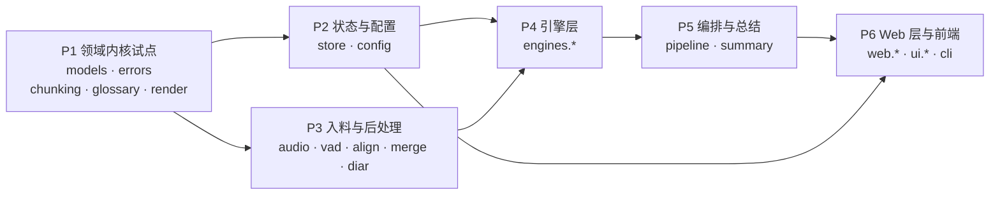

# 现代化方案书 — transcript

**版本**：2（按 Phase 1 试点实测重新生成）
**日期**：2026-10-17
**输入时间戳**（本方案的全部依据）：

| 输入 | 时间 | 本方案怎么用它 |
|---|---|---|
| `INTENT.md` | 13:21 | 目标（reimagine → 模块化单体）、硬约束（顺手修已知 bug）、范围边界 |
| `PREFLIGHT.md` | 13:27 | 人的五个回答 + Check 6 范围边界（独立仓库，无外部消费者） |
| `ASSESSMENT.md` | 13:47 | 规模、复杂度、技术债 top 10、安全发现、推荐模式（Rearchitect） |
| `topology.json` + `*.mmd` | 14:11 | 12 个领域、106 条边、4 个人话流程、2 个死端 |
| `BUSINESS_RULES.md` / `DATA_OBJECTS.md` | 15:08 | 140 条规则、40 个数据对象 |
| `RULE_REVIEWS.json` / `RULE_REVIEWS.md` | 15:19 | 人的 12 条裁定（5 确认 / 7 判错 / 0 待议） |
| **`PLAYBOOK.md`** | **Phase 1 收口** | **十二步标准动作、四条结构约定、三道门禁 —— v2 的执行依据** |
| **`SCAFFOLD_REVIEW.md` / `DEAD_CODE_REMOVED.md`** | **Phase 1 收口** | **736 行重复的处置、34 个死文件的删除记录** |
| **Phase 1 实测** | **Phase 1 收口** | **542 通过 / 2 跳过 / 41 xfail；3 条分层契约 kept；端到端写出三个产物** |

无 `DELTA_CATALOG.md`，本次**不需要** —— 目标不是同栈升版本。

**批准者注意**：本文件是执行时的绑定契约。每个阶段的 `Modules` 与各项 criterion 会被 `/code-modernization:modernize-reimagine` 直接读取。**想改执行方式，就编辑本文件**——被编辑的 criterion 会被遵从，聊天里说的话不会。改动某条 criterion 时请另起一行 `Proposed revision:`，不要直接重写。

---

## 1. Objective

把 `transcript`（本机单人转录工具，6,897 SLOC 产品代码）**按新架构重建为模块化单体**：仍是一个进程、仍只绑 `127.0.0.1`、仍让 MLX 模型在 lifespan 里常驻，但把转录流水线、引擎注册表、存储、Web 层划成边界清楚的模块包。**现在做的理由**：这套代码的领域层（`models`/`errors`/`config`/`audio`/`vad`/`chunking`/`align`/`merge`/`glossary`/`render`/`store`/`engines`）依赖单向、注释充分、有 264 个通过的测试钉住行为——**它是这套代码里最好的部分，重写它等于用风险换零收益**；而全部结构性问题都长在领域层之外：`web/app.py` 是 743 行、复杂度 171 的单个闭包函数，25 条路由零可测接缝；`task.tsx` 是 1,271 行、复杂度 281 的单组件；另有约 10,400 行没有任何路由挂载的死代码。所以这次重建是**外科手术式的「保域换壳」**，同时按 `INTENT.md` 的硬约束把 7 条经人裁定为缺陷的规则顺手修掉。

**不做的事**（沿用 `PRODUCT.md`，重建不是加功能的机会）：实时听写、批量排队、翻译、云端/多用户、鉴权。

---

## 2. Target Architecture



### 旧 → 新 组件映射

| 旧组件（`topology.json` id） | 目标组件 | 处置 |
|---|---|---|
| `models` `errors` `config` | 核心契约包（域类型 / 错误分类法 / 配置） | **近乎原样搬运**；`config` 修 RULE-105（数值解析吞异常） |
| `audio` `vad` `chunking` | 入料与切片包 | **近乎原样搬运**（边界已干净；`chunking` 是纯函数） |
| `align` `merge` `glossary` `render` | 后处理包 | **近乎原样搬运**；`merge` 必须保持 P0 规则（正文零丢失） |
| `engines.base` + 4 个适配器 | 引擎层：`Engine` 协议 + `SPECS` 注册表 + 每引擎一适配器 | **保留注册表为唯一真相来源**；`offline` 修 RULE-129（删掉死分支） |
| `pipeline` | 编排模块 | 行为保留（含 P0 规则）；**落盘决策改为单点**（修 RULE-061 的 artifact 缺口） |
| `store` | 仓储层 | **收敛为 state.db 的唯一写入者**（现在有 5 个写入方绕过它） |
| `summary` | 总结模块 | 行为保留；去掉 `SummaryContent` 死模型与手写截断的双份契约 |
| `diar` | **待定** | 二选一：接通（config → API → UI → srt/txt）或移出 `src/`。见开放问题 Q8 |
| `web.app` `web.jobs` `web.frontend` | Web 层：按资源切分的路由模块 + 任务调度 + 构建门禁 | **推倒重写**（743 行 god function → 无闭包、依赖显式注入） |
| `ui.main` `ui.task` `ui.lib` `ui.components` | 前端：先定一种状态/数据/路由策略，再按页拆 | **推倒重写**；删 9 个未用组件与 3 个未用依赖 |
| `cli` | CLI | 保留四个子命令；改为调用新 Web 层与编排模块 |
| `workbench` `spikes` | **删除 / 归档** | `src/` 那份 workbench 拷贝与 `spikes/workbench/.baseline/` 删除；`spikes/` 原件保留为研究产物 |
| `ds:state_db` `ds:config_env` `ds:user_text` `ds:uploads` `ds:artifacts` | 存储（不变） | 逻辑标识不变；`config.env` 与热词的写入统一走**一个**原子写辅助函数 |

**架构约束（重建时必须保持的物理特性）**：单进程；仅绑 `127.0.0.1`；MLX 权重在 lifespan 内常驻（离线路径的性能前提）；离线为默认，在线必须显式开启；分片是唯一的重试与落盘单位。

---

## 3. Phased Sequence

排序方式：**strangler fig**（跨栈重写）—— 依赖最少、风险最低的先做。Phase 1 是**试点**，本方案是**假设**。

> **预期本方案会被修订。** 试点要回答的不是「这个模块能不能重写」（显然能），而是「重写一个模块的标准动作是什么」：等价性怎么证明、测试怎么搬、构建产物怎么验证。试点大概率会翻出分析没看见的东西——一条漏掉的 delta、一个顺序错的前置条件、一个没人写下来的环境事实。**试点之后重新生成本文件是正常路径，不是计划失败。** 遗留系统把意外藏在构建和运行里，不在源码里。



#### Phase 1 — 领域内核试点

Command: /code-modernization:modernize-reimagine
Modules: models, errors, chunking, glossary, render
Scale: S
Risk: 低；**两个主要风险**——(1) 重写时把 `errors.py` 的 `RecoverableError` / `FatalError` 分层当成描述性标签而非重试策略，破坏整条编排的重试语义（缓解：把它写成显式规则卡并在测试里断言分类结果）；(2) 注释里承载的不变量在搬运中失传，例如 `chunking.py` 的 `duration <= max_s` 是 300s 上游上限不被击穿的唯一保障、`merge.py` 的保守去重阈值来自一次真实事故（缓解：`extract-rules` 已把这些挖成规则卡，逐条落成测试）。

**首批切片**：`chunking` + `render`。两者都是纯函数、零副作用、有现成测试，是验证「重写一个模块的标准动作」的最小代表单元——先做它们，把动作跑通，再套用到同批的其余三个。

> **Proposed revision:（Checkpoint 2，2026-10-17，已批准）** Entry criteria 增补一条：Phase 1 的脚手架必须包含**一条可执行的纵向切片** —— 三个包（`domain` `post` `ingest`）+ 一个最小的 `run` 入口（读一份音频元数据 JSON：时长、语音区间、一段文本 → 走 `chunking` → `glossary` → `render` → 写出真实的 `.txt`/`.srt`/`.raw.json`）。
>
> **理由**：本阶段 5 个模块全是纯函数、零副作用、已有现成测试。只搬它们，试点碰不到任何真实接缝（文件 I/O、跨包 import 图、产物落盘），产出的 `PLAYBOOK.md` 会是关于复制粘贴的证据，而不是本方案自己要求的「重写一个模块的标准动作」的证据。
>
> **范围约束（按初衷收紧）**：纵向切片**不含 `config`、不含 `store`**。加 `config` 会把 Phase 2 的范围提前，而 `config` 的缺陷修复（RULE-105）绑定在 Phase 2 —— 若 Phase 1 就引入它，就必须按「逐字节等价」重现它的缺陷行为，白做一遍。切片要碰到的是**文件 I/O 与跨包 import**，不是 SQLite。

Entry criteria:
- [x] `analysis/transcript/BASELINE.md` 已记录：快照测试套件在 `legacy/transcript` 上的运行结果（264 通过 / 2 失败 / 10 跳过 / 8.9s），以及那 2 个失败的测试名
- [x] 死代码已按 `ASSESSMENT.md` 技术债 #3 处置 —— 已删除 `src/transcript/web/static/workbench/**` 与 `spikes/workbench/.baseline/**`（清单与恢复方式见 `analysis/transcript/DEAD_CODE_REMOVED.md`），复杂度基线已重算
- [x] 本阶段 5 个模块的规则卡已逐条读过 —— `RULE-011` `012` `021` `022` `025` `059` `060` `062` `132` `135` `136`，共 11 条，已写入 `AI_NATIVE_SPEC.md` §5.2 作为验收判据
- [x] 规格与架构已产出：`AI_NATIVE_SPEC.md`、`REIMAGINED_ARCHITECTURE.md`（v2），Checkpoint 1 与 Checkpoint 2 均已裁定
- [x] 新项目的骨架已建在 `modernized/transcript-reimagined/`，且 `legacy/transcript` 未被改动
- [x] **（Proposed revision）** `run` 入口存在，且能在真实文件系统上端到端跑通一次并写出 `.txt`/`.srt`/`.raw.json`

Exit criteria:
- [x] `chunking` 与 `render` 的等价性已证明：一组输入下新旧实现输出逐字节一致，包括 `chunking.py:37-93` 的分片预算与不变量
- [x] 其余 3 个模块（`models` `errors` `glossary`）同样逐字节等价，或每一处差异都已列为「已接受的差异」并署名
- [x] `errors.py` 的重试分类有显式测试：`classify_http` 对 408/409/425/429/5xx 的映射与对参数/格式/额度类错误的直接暴露
- [x] **（Proposed revision）** `run` 入口的产出与 `legacy` 版在相同输入下逐字节一致（这是「等价」第一次在真实文件上被证明，而不是在单元测试里）
- [x] 试点得出的「重写一个模块的标准动作」已写成 `analysis/transcript/PLAYBOOK.md`，且本方案已按它重新生成（即本 v2）

**Phase 1 实测（v2 的依据）**：

| 指标 | 实测 |
|---|---|
| 测试 | **542 通过 / 2 跳过 / 41 xfail**（真实执行，非空跑） |
| 分层契约 | **3 kept / 0 broken**（`domain` 是叶、`runner → {ingest,post} → domain`、重建版不包装 legacy） |
| 端到端 | 真实写出 `.txt` / `.srt` / `.raw.json`，含词表替换头注释 |
| 结构 | uv workspace + **PEP 420 命名空间**，四个成员包：`domain` `ingest` `post` `runner` |
| 去重 | 删掉 `runner` 里被结构逼出的 **736 行**副本；补上缺失的 NFR-11 常量 `MAX_ATTEMPTS` / `BACKOFF_BASE_S` / `is_recoverable` / `retry_delay_s` |
| 合跑成本 | 合并并行脚手架的主要成本在**测试基建**（`--rule` 重复注册、8 组同名测试文件、conftest 同名遮蔽），不在业务代码 |

#### Phase 2 — 状态与配置

Command: /code-modernization:modernize-reimagine
Modules: store, config
Scale: S
Risk: 中；**两个主要风险**——(1) `store` 现在名义上是仓储、实质上有 5 个写入方绕过它（`pipeline`/`web.jobs`/`web.app`/`cli`），收敛时不慎会改变任务在 UI 上的可见时机（缓解：把「分片完成即落库」写成不变量测试，而不是靠调用方的纪律）；(2) `config.env` 的写入现在有三份实现、安全级别不同（`config.save_credentials` 是无人调用的正确版本，实际在用的是 `app.py` 里两份 ad-hoc 写入），合并时若选错基准会降低安全性（缓解：以 `save_credentials` 为规格，其余删除）。

> **Proposed revision:（v2，按 Phase 1 实测）** 本阶段的包名与实现基线固定如下：
>
> 1. **包名用 `state`，不用 `store`。** `REIMAGINED_ARCHITECTURE.md` §2 已把仓储层命名为 `state`；`store` 只是遗留模块名。`state` 包承载 `state.db` 的唯一写入者，`config` 包承载配置与用户文件的原子写。
> 2. **`state.db` 保留、不重建、schema 不变。** 沿用现有三张表与一个索引；启动时只做幂等加列迁移（`segments_json`、`progress`），不做一次性迁移脚本。理由是回滚姿态：任何时刻旧代码仍能接管同一份库。
> 3. **原子写只有一个通道。** `config` 包提供 `atomic_write(path, text, *, mode=0o600, preserve_comments=False)`（临时文件 + `os.replace` + `chmod`），`config.env`、`glossary.txt`、`summary-prompt.txt` 的写入全部走它；不允许第二份 `write_text` 实现。
> 4. **「空值 = 保留」是 API 层语义，不是写文件层语义。** 写文件层把空串当作「清空这一项」（`save_credentials` 的现有行为），API 层在调用前过滤掉空输入；两层各自有测试，避免像 legacy 那样把两条语义混在一处。
> 5. **工作区新增 `config` 与 `state` 两个成员包**，同步扩展 `pyproject.toml` 的 workspace members、`tool.uv.sources`、`testpaths` 与 import-linter 契约（`config` 只依赖 `domain`；`state` 只依赖 `domain`；两者都不许 import 上层包）。

Entry criteria:
- [x] Phase 1 的 exit criteria 全部为真
- [x] 已选定**一个**原子写辅助函数作为所有用户文件变更的唯一通道（临时文件 + `os.replace` + `600` + 保留用户注释）
- [x] `state.db` 的 schema 迁移策略已书面确定（现有 `_migrate` 只做加列；重建后是否沿用、是否需要一次性迁移脚本）

Exit criteria:
- [x] `state.db` 只有一个写入者：`grep -rn "state.db\|sqlite3.connect" src/` 只命中仓储层
- [x] 任务生命周期的终态集合 {done, failed} 有显式测试，且「运行中但无进程」这一状态由服务端明确给出，不再由前端四处推断
- [x] RULE-105 已修：`config.env` 里的数值解析不再静默吞 `ValueError`，手误（如 `CHUNK_MAX_S=12O`）在启动时可见
- [x] 配置优先级（config.env > 旧版设置文件 > 内建默认）有契约测试覆盖

**Phase 2 实测**：600 通过 / 2 跳过 / 41 xfail；6 条分层契约 kept。唯一命中 `state.db` 的非仓储文件是
`config/settings.py` 的 `DEFAULT_STATE_DB` 路径常量（不写库）。「运行中但无进程」由
`state.task_flags(task, live_task_ids)` 单点给出。

#### Phase 3 — 入料与后处理

Command: /code-modernization:modernize-reimagine
Modules: audio, vad, align, merge, diar
Scale: M
Risk: 中高；**两个主要风险**——(1) `merge.py` 承载 **P0 规则**（正文零丢失），一次真实事故里句级去重吃掉了 87 分钟录音中的 111 个字符，阈值刻意保守；重写时任何「顺手简化」都可能复现该事故（缓解：P0 规则进回归套件，且用**修正后的**例子做判据，见 §5）；(2) **Q8 已裁定为「接通成端到端功能」，这是一个扩大范围的决定**——`diar` 是绑定到带版本哈希的第三方 dylib 的 ctypes FFI 模块，当前无任何测试能执行它，接口面（路由 / UI / `srt`）全缺，且 `PRODUCT.md` 把它列为非目标（缓解：三项前置工作见 §7c Q8，必须在写检测代码之前完成）。

Entry criteria:
- [x] Phase 2 的 exit criteria 全部为真
- [x] **Q8 的三项前置工作已全部完成**（见 §7c）：(a) `PRODUCT.md` 已更新、不再把说话人分离列为非目标；(b) 接口面缺口已列成清单（config → API → UI → `srt`/`txt` 双产物，其中 `to_srt` 现在完全忽略 `speaker`）；(c) **ABI 验证夹具已建立**——`tests/data` 里补上分离夹具，且有一个测试能真正执行 `diar.py` 的 ctypes 结构体（当前为零）
- [x] RULE-001（P0）的判据例子已按 `RULE_REVIEWS` 的评委意见修正：重叠必须 ≥ `_MIN_OVERLAP_CHARS = 4` 才会被剥掉，「开会。」这种 3 字符重叠不会被去重

> **Proposed revision:（Checkpoint 2，2026-10-17，已批准）** 本阶段的 `diar` 范围**收窄为仅离线路径**。
>
> **依据**：`pipeline.py:331` 的分支条件是 `if self.config.enable_diar and mode == "offline" and merged.segments` —— 分离**只在离线模式执行**；在线引擎返回的 `Segment` 里 `speaker` 恒为 `None`。因此「接通端到端」在事实上只对离线路径成立。
>
> **为什么不推翻它（按初衷）**：让在线路径也输出 speaker 需要在线引擎产出说话人信息，而四个引擎里没有一个提供 —— 这会变成**新增一个能力**，不是重建。本方案的定位是重建，`PRODUCT.md` 的非目标里也包括说话人分离；C8 是唯一一处经人裁定放行的扩展，其边界就是「把已经写好的东西接通」，到此为止。
>
> 验收判据相应改为：**离线路径**上 config → API → UI → `srt`/`txt` 双产物全部接通；在线路径**保持 `speaker` 为 `None`**，且这一点有测试断言（避免以后有人误以为在线也支持）。

Exit criteria:
- [x] `merge` 的 P0 行为在回归套件中逐条通过，且**包含**一个「不足最小重叠长度时正文原样保留」的反向用例
- [x] `align` 的单调时间不变量有性质测试：任意输入下时间戳不减、每个字有归属
- [x] `chunking` 的 `duration <= max_s` 不变量对全部在线引擎的声明的上限都成立，包括 300s 的百炼硬限
- [x] **`diar` 已按 Q8 接通为端到端功能**，且验收包含：config → API → UI 三处都能开启；**`srt` 与 `txt` 都输出说话人**（`to_txt` 的 `[speaker_N]` 前缀在 `to_srt` 里同样存在）；有一个测试真正执行了 ctypes ABI 并通过；`diar.py` 对第三方 dylib 构建哈希的隐式依赖已被测试钉住
- [x] 已知缺陷已修：`engines/offline.py` 的时间戳兜底死分支已按裁决删除（见 Q3）——若本阶段先于 Phase 4 完成，则该修复随 Phase 4 落地

**Phase 3 实测（已闭合）**：`config` 开关、`GET/PUT /api/diar-settings`、控制台「更多设置」开关、
`srt`/`txt` 双产物、ctypes ABI（stub dylib + 真实库 smoke）、构建哈希钉住全部完成。
离线死分支在 Phase 4 删除；`diar` 的接口缺口清单见 `DIAR_INTERFACE_GAPS.md`。

#### Phase 4 — 引擎层

Command: /code-modernization:modernize-reimagine
Modules: engines.base, engines.offline, engines.dashscope, engines.openrouter, engines.bcut
Scale: M
Risk: 中高；**两个主要风险**——(1) 引擎选择是**配置驱动的分发**（`SPECS` 注册表 + `artifact` 决定），静态 import 图看不到，重写时最容易丢掉的恰恰是这张注册表作为单一真相来源的地位（缓解：把注册表写成显式规则卡，并断言 `resolve_kind` 的 auto 映射 `txt→dashscope`/`srt→openrouter`）；(2) 云端引擎的失败分类直接决定重试与花钱，`bcut` 的 412 封禁还会触发 90 秒自罚冷却（缓解：把每个引擎的失败分类写成契约测试，用录制的响应夹具，不发起真实付费调用）。

Entry criteria:
- [x] Phase 3 的 exit criteria 全部为真
- [x] 四个引擎各自的失败分类与上限已从 `BUSINESS_RULES.md` 中提取成独立规则卡
- [x] RULE-129（离线时间戳兜底死分支）的处置已书面确认（见 Q3）

Exit criteria:
- [x] `SPECS` 注册表仍是引擎 id / 所需凭据 / `max_chunk_s` / 成本文案的唯一来源，无第二处硬编码
- [x] 每个引擎的单次上限都在**本地**拦住超限分片，不靠上游报错，也不为此花钱（含百炼 300s 的本地拦截）
- [x] 在线引擎的凭据缺失时的就绪判定与「至少一个在线引擎无需凭据即可用」的规则有测试
- [x] 已知缺陷已修：不得存在任何无条件写产物或重跑同一次调用的分支

**Phase 4 实测**：`engines/tests` 覆盖注册表、4 个适配器、夹具回放与失败分类；离线引擎的
第二次 `_whisper_words` 调用已删除（测试断言只调用一次）；OpenRouter 增加本地体积闸门。

#### Phase 5 — 编排与总结

Command: /code-modernization:modernize-reimagine
Modules: pipeline, summary
Scale: M
Risk: 中高；**两个主要风险**——(1) `pipeline` 承载 **P0 规则**（全部分片成功才 done；任一分片失败则任务 failed 且**不写** txt/srt），这是产品的出口契约，且必须与「分片保留可续跑」同时成立（缓解：P0 规则进回归套件，并单独测「失败后 txt/srt 不存在但分片仍在库」）；(2) 落盘决策现在是**两次独立的 `_write` 调用**、`artifact` 只把关了一半，重建时若不改成单点决策会原样复现该缺陷（缓解：把产物选择做成单个写决策，并有测试断言 `artifact=txt` 时 `.srt` 不存在）。

Entry criteria:
- [x] Phase 4 的 exit criteria 全部为真
- [x] RULE-072（P0）的判据例子已按评委意见修正：6 分片任务的失败场景应写作「分片 0-2 与 4-5 成功、分片 3 失败」，原卡的「0-4 成功」与「分片 3 失败」自相矛盾
- [x] RULE-061（「对，但顺手补齐」）已转为明确的验收条件：`artifact=txt` 时不得产出 `.srt`

Exit criteria:
- [x] P0 行为在回归套件中逐条通过：任一分片失败 → 任务 failed 且 `.txt`/`.srt` **都不存在**、已完成分片仍在 `state.db`
- [x] `artifact=txt` 的任务不产生 `.srt`；`artifact=srt` 且引擎无时间戳时任务失败且两个文件都不写
- [x] 续跑复用已完成分片、不重复付费，只重跑声明的两种特例，有测试覆盖
- [x] 断点续跑有端到端验证：杀进程后重启，已完成的分片未重跑（真实子进程 `os._exit` 测试）
- [x] `summary` 的输出契约只有**一处**实现（不再是 Pydantic 模型与手写字符串截断各一份）；总结开启后独立于转录成败（转录不会因总结失败而失败）
- [x] 端到端：一个新任务的 `.raw.json` 能被下游消费，且产物与 `legacy` 版在相同输入下逐字节一致

**Phase 5 实测**：`orchestrate/tests/test_legacy_e2e_equivalence.py` 用真实 ffmpeg 生成 12s 音频，
新旧 Pipeline 在同一输入下三个产物**逐字节一致**；`test_p0_lifecycle.py` 覆盖修正后的
「0-2 与 4-5 成功、3 失败」6 分片场景。

#### Phase 6 — Web 层与前端

Command: /code-modernization:modernize-reimagine
Modules: web.app, web.jobs, web.frontend, ui.main, ui.task, ui.lib, ui.components, cli
Scale: XL
Risk: 高；**两个主要风险**——(1) 这一层完全没有可测接缝（`create_app` 是单个 635 行闭包，25 条路由全是嵌套函数），重写时必须先定接缝再写路由，否则新代码会继承同一个形状（缓解：按资源切分路由模块、依赖显式注入，先为一个资源（如 outputs）做出可独立测试的样板再铺开）；(2) 前端同时存在三个未使用的依赖与两套并行的机制（手写 fetch / 手写路由 vs 已安装未用的 react-query / react-router / zustand），重写时必须**先定一种**，否则会把「记录了所有没人选的方案」这件事复制一遍（缓解：定策略作为 entry criterion，删掉未用组件与依赖作为 exit criterion）。

Entry criteria:
- [x] Phase 5 的 exit criteria 全部为真
- [x] 前端已**先定下一种**状态/数据/路由策略并写入文档（不是「都可以」）
- [x] 安全前置项已确认：来源校验中间件（`Host` 白名单 + 非 GET 路由的 `Sec-Fetch-Site`/`Origin` 校验）将随本阶段落地
- [x] **Q11 已落地**：`/api/upload` 已删除，`tests/test_web.py:394` 的对应测试同步移除
- [x] **Q1–Q6 与 Q10 的裁定已逐条转为本阶段模块的验收条件**（`ui.task` `ui.main` `ui.components` `web.app`）

Exit criteria:
- [x] `create_app` 等价物不再存在：没有单一函数定义全部路由；每个资源模块可独立构造并测试
- [x] 9 个未用 shadcn 组件与 3 个未用 npm 依赖（`react-router-dom` `@tanstack/react-query` `zustand`）已删除，`package.json` 与源码一致
- [x] 结构化日志落地：每次失败有任务/请求关联 id 与错误码，不只是插值后的异常文本
- [x] 来源校验中间件生效：`Host` 非 `127.0.0.1`/`localhost` 的请求被拒，非 GET 路由要求同源
- [x] **Q1** 空输入不再发送空密钥值（空 = 无操作）；**Q2** 模型列表先计数再截断；**Q4** 已完成分片不再丢弃 `text`；**Q5** 无音频来源时前端直接拦住；**Q6** 停止动作有明确中间态；**Q10** 「运行中但无实时进程」由服务端给出、前端不再推断
- [x] 4 条人话流程（§4）在新系统上端到端走通，含「边转录边校对」的增量可见与「断点续跑」
- [x] 前端构建门禁保留：产物缺失或过期时服务拒绝启动，且**绝不**自动 `npm install`
- [x] `tests/` 的 264 条断言已搬成新回归套件（Q13 裁定），每处省略都有署名理由

**Phase 6 实测**：资源路由 7 个模块、13 条分层契约、`web/tests` 覆盖来源校验/结构化日志/
任务生命周期/设置/产物/SSE/前端门禁；前端 `npm test` 11 条通过，产物已构建并纳入仓库。
**人工 UAT 的边界**：默认套件不下载 MLX 权重、不发起真实付费调用；`test_smoke.py` 的真实模型
听感与在线引擎实测按方案书 §6 的人工验收列执行。自动化链路已覆盖四条流程的机制。

---

## 4. Business Walkthroughs

| 流程 | 谁经历它 | 发生什么（业务语言） | 实现的旧模块 | 本方案哪个阶段替换 |
|---|---|---|---|---|
| **深夜批量整理：把一个录音变成字幕** | 在深夜整理会议录音的项目所有者 | 拖入音频 → 选离线/在线与产物 → 浏览器副本落到本机 → 切静音、归一化、规划分片 → 逐片转写 → 对齐时间轴、去重、套热词 → 渲染并落到原文件旁 | `ui.main` `ui.lib` `web.app` `config` `engines.base` `pipeline` `audio` `vad` `chunking` `engines.offline` `engines.dashscope` `align` `merge` `glossary` `render` | P1（chunking/glossary/render）· P3（audio/vad/align/merge）· P4（engines）· P5（pipeline）· P6（web/ui） |
| **边转录边校对：已完成的分片立刻可见** | 想在转录还没跑完时就开始改错字的人 | 打开任务详情页 → 每片完成即写入本地库 → 服务端把进度与分片文本推给页面 → 页面增量追加字幕与文稿 → 改热词后重新生成产物 | `ui.task` `ui.lib` `pipeline` `store` `web.jobs` `web.app` `glossary` | P2（store）· P5（pipeline）· P6（web/ui）——**注意 RULE-007 判为缺陷：同时带 segments 与 text 的已完成分片会丢弃 text** |
| **断点续跑：进程被杀也不重复付费** | 转录到一半被迫关机、又不想重花钱的人 | 任务中断，已完成分片留在本地库 → 重新打开时识别可续跑 → 复用缓存分片，只补缺口 → 补完后才写产物（失败不写半成品） | `pipeline` `store` `web.app` `web.jobs` `engines.base` `render` | P2（store）· P4（engines.base）· P5（pipeline）· P6（web） |
| **显式开启 Agent 总结：从转录文本到要点与待办** | 开完会想把两小时录音直接变成行动项的人 | 在任务详情页显式开启总结 → 服务端读配置与热词、组装提示词 → 转录文本与提示词发往配置的 Base URL（**不上传音频**）→ 流式回传正文，思考过程折叠 | `ui.task` `web.app` `summary` `config` `glossary` | P2（config）· P5（summary）· P6（web/ui） |

**给非技术批准者的一句话**：这四条流程在重建后必须一条都不少、一条都不降级。其中第二条目前带一个已知缺陷（已完成分片的内容可能显示不全），已裁定为要修。

---

## 5. Behavior Contract

以下是系统核心目的所依赖、或一旦出错代价高昂且不可逆的规则。**它们在任何阶段交付前必须被证明等价**，并构成回归套件。

| 规则 | 内容 | 来源 | 置信度 | 人的裁定 |
|---|---|---|---|---|
| `merge.py:82-119` | **分片边界去重、绝不丢正文**：重复文字只在两个分片拼接处去掉；只在切完还剩非空内容时才丢弃；时间戳重叠单独修 | `BUSINESS_RULES.md`（P0，Calculation） | Medium | ✅ **confirmed**（「对，就这么做」） |
| `pipeline.py:316-326` | **任务与分片状态生命周期；不产出残缺产物**：全部分片成功才 `done`；任一分片失败则任务 `failed`、`.txt`/`.srt` 都不写、已完成分片留在库里 | `BUSINESS_RULES.md`（P0，Lifecycle） | Medium | ✅ **confirmed**（「对，就这么做」） |

### ⚠️ 两条 P0 都需要先修正判据例子（不阻塞，但必须先做）

两条都是 **Medium** 置信度，按规程属于「交付前需要 SME 确认」。人已确认**规则陈述本身**成立，但 P0 双评委小组**实际执行了被引用的函数**，证明两条卡里的**具体例子写错了**。因此：

1. **规则陈述** = 契约，照做。
2. **例子** = **不得**直接当测试判据。按下面的修正值重写判据后，才算可以进回归套件。

| 规则 | 卡里写的（错） | 实际行为（评委执行验证） |
|---|---|---|
| `merge.py:82-119` | 头部 `开会。`（3 字符）被剥掉 | `longest_overlap` 要求 ≥ `_MIN_OVERLAP_CHARS = 4`；3 字符重叠检出为 0，**重复文本原样保留**。修正判据：用 ≥4 字符的重叠（如前段以 `…开会。请` 结尾） |
| `pipeline.py:316-326` | 「分片 0-4 成功、分片 3 失败」 | 自相矛盾（0-4 含 3）。修正判据：**「分片 0-2 与 4-5 成功、分片 3 失败」** |

另有一处常量不一致需记录：`merge.py` 的 docstring 写覆盖率 70%，可执行常量 `_MIN_COVERAGE = 0.8`。docstring 里的「87 分钟录音丢 111 字符」是**注释声明**、不可从代码验证，但它解释了阈值为何保守——保留该意图。

**为什么这两条是 P0**：`merge_segments` 是把分片转写变成最终交付物的那一步，去重范围写错会**静默删除真实句子**（不可逆、离线场景下源音频可能已不在）；`pipeline` 的出口契约决定「看起来完整的转录」能否被误当成完整产品。两者都是数据完整性，不是众多校验中的一条。

---

## 6. Validation Strategy

每个阶段适用的组合（不适用即不列）：

| 阶段 | 特征化测试 | 契约测试 | 双执行 diff | 性质测试 | 人工 UAT |
|---|---|---|---|---|---|
| **P1 领域内核** | ✅ 主手段：纯函数模块，逐字节比对 | ✅ `errors` 的分类映射 | ✅ `chunking`/`render`/`glossary` 新旧并行 | ✅ `chunking` 的分片不变量 | — |
| **P2 状态与配置** | ✅ schema 与迁移 | ✅ 生命周期终态、配置优先级 | ✅ 同一串操作下 `state.db` 的行内容 | — | ✅ 手误配置能被看见 |
| **P3 入料与后处理** | ✅ `audio` 的探测与归一化契约 | ✅ **P0 规则**（含反向用例） | ✅ 同一音频下 `.srt` 逐行一致 | ✅ `align` 单调时间不变量 | ✅ 一条真实录音听感抽查 |
| **P4 引擎层** | ✅ 录制的响应夹具 | ✅ 每个引擎的失败分类、单次上限本地拦截、就绪判定 | ⚠️ 受限：真实付费调用不做双跑，改用录制夹具回放 | — | ✅ 一次真实在线转写（含 412 冷却） |
| **P5 编排与总结** | ✅ 分片级检查点 | ✅ **P0 规则**（失败不写产物 + 分片保留）、`artifact` 落盘单点决策、续跑不重跑 | ✅ 端到端产物逐字节比对 | — | ✅ 杀进程后续跑的实操验证 |
| **P6 Web 层与前端** | — | ✅ 每条路由的请求/响应契约（先从 `outputs` 做一个可独立测试的样板） | — | — | ✅ 4 条人话流程手走一遍，含来源校验生效验证 |

**贯穿全部阶段的门禁**：
- 每个阶段结束时，`legacy/transcript` **必须仍未被改动**（它是基准，不是待改代码）。
- 每一处「已接受的差异」都要署名并写明理由；未署名的差异视为失败。
- 前端构建产物必须在服务启动时被验证（沿袭 `validate_dist` 的硬门槛语义）。

---

## 7. Open Questions — 已全部裁定

**全部 13 项均由人裁定完毕（2026-10-17）。** 本节保留裁定内容作为执行时的依据；不再有待决项。

### 7a — 人已裁定为「不对」的 7 条规则（不在契约里、按裁定改写）

这 7 条**不算落定**：不会作为「照旧实现」的指令，而是「重写时按裁定改掉」的清单，并**阻塞其模块所在阶段**。

- [x] **Q1（阻塞 P6）** `frontend/src/main.tsx:42-55` — 空输入框会发送空密钥值，可摧毁正在用的凭据。裁定：**缺陷**。空输入应当是无操作，不是写入空值。
- [x] **Q2（阻塞 P6）** `frontend/src/task.tsx:384-394` — 60 条上限在计数之前生效，匹配项可能滚不到。裁定：**缺陷**。先计数再截断，或让截断后的位置可发现。
- [x] **Q3（阻塞 P4）** `src/transcript/engines/offline.py:100-110` — 时间轴兜底是死分支，一旦触发把成本翻倍。裁定：**死分支**。重写时词级时间轴只算一次，让 `align` 报告退化原因（等时平摊），而不是用第二次模型调用把原因盖住。
- [x] **Q4（阻塞 P6）** `frontend/src/task.tsx:85-102` — 已完成分片同时带 `segments` 与 `text` 时，`text` 被静默丢弃。裁定：**缺陷**。以 `segments` 为准，并去掉那份冗余 `text` 以免歧义。
- [x] **Q5（阻塞 P6）** `frontend/src/main.tsx:203-219` — 前端缺「必须有音频来源」的守卫，误提交要多跑一趟服务端。裁定：**缺陷**。（服务端有校验，这是体验缺陷不是安全漏洞。）
- [x] **Q6（阻塞 P6）** `frontend/src/components/history-sidebar.tsx:104-111` — 点停止不做乐观更新，到下次轮询前毫无反馈，且与详情页的「正在取消」状态不一致。裁定：**缺陷**。需要有明确的中间态。
- [x] **Q7（阻塞 P2）** `src/transcript/config.py:131-201` — 数值配置解析包在 `contextlib.suppress(ValueError)` 里，`CHUNK_MAX_S=12O` 这类手误静默回退默认值。裁定：**缺陷**。解析不应吞异常，至少要可见。

### 7b — 人已确认、但带附加要求的规则

- [x] **Q9（阻塞 P5）** `src/transcript/pipeline.py:347-352` — 裁定「**对，但顺手补齐**」，且**验收写法已确认**：规则本身保留（`artifact=srt` 且引擎无时间戳 → 任务失败、两个文件都不写）；补齐的是另一半 —— **`artifact=txt` → 只写 `.txt`，不写 `.srt`**（`srt_path is None` / 端点 404，与 `test_pipeline.py:174`、`test_web.py:298` 断言的**方向一致**）。原有的 srt 路径行为不变。
- [x] **Q10（阻塞 P6）** `frontend/src/task.tsx:945-951` — 裁定「**对，但需去重**」，且**改由服务端判定**：由服务端明确给出「运行中但无实时进程」这个状态（专门的 interrupted 状态，或在 API payload 里显式的 `is_interrupted`），前端不再自行推断。同一套状态推导现重复三处，重写时只留一处。

### 7c — 分析阶段遗留、已由人拍板的判断题

- [x] **Q8（阻塞 P3）** **说话人分离：裁定为「接通成端到端功能」。**

  这是一个**扩大范围的决定**，与本次现代化的「非目标即承诺」原则直接相冲，执行时必须一并处理三件事：

  1. **`PRODUCT.md` 必须更新** —— 它现在明确把「说话人分离」列在非目标里。不更新文档就等于让代码与规格继续互相矛盾。
  2. **接口面必须补齐** —— 从只能手改 `config.env` 的 `ENABLE_DIAR`，接通到 config → API → UI → **`srt`/`txt` 双产物**。目前 `to_txt` 会渲染 `[speaker_N]` 前缀而 `to_srt` 完全忽略 `speaker`，两个产物必须一致输出。
  3. **验收条件必须包含 ABI 验证** —— `diar.py` 是 ctypes 绑定到带版本哈希的第三方 dylib（`diar.py:21-30` 硬编码 `…/NeMoSpeech/main-97a15af/…`），当前**没有任何测试能执行它**，`tests/data` 里也没有夹具。接通前必须补上夹具与 ABI 验证测试；预设字符串 `b"v3-offline"` 与 10 字段 `_ModelCfg` 结构体与该构建哈希静默耦合，这是长期升级风险，必须在测试里钉住。

- [x] **Q11（阻塞 P6）** **`/api/upload`：裁定为「删掉」。** 它与 `/api/tasks` 的上传分支重复，却不检查 `MAX_UPLOAD_BYTES`（2GB）也不校验后缀，会把无上限的请求体落到同时装着 `state.db` 与全部产物的目录；且无任务记录指向它、也无清理。目前唯一调用方是 `tests/test_web.py:394`，删除时同步移除该测试。
- [x] **Q12（阻塞 P1）** **死代码：裁定为「按建议删」。** 删除 `src/transcript/web/static/workbench/**`（13 文件 4,233 行，无任何路由挂载）与 `spikes/workbench/.baseline/**`（第三份拷贝 5,872 行）；**保留 `spikes/workbench/` 原件的 README 与 ABLATION 记录**作为研究产物。共减约 10,400 行。
- [x] **Q13（阻塞 P1）** **重建范围：裁定为「测试搬、探针归档」。** `tests/`（3,644 行、264 条断言）**要搬成新回归套件** —— 这是 Phase 6 的 exit criterion；`spikes/`（一次性探针）**只归档，不进重建**。

---

## 8. Approval Block

```
Approved by: 项目所有者            Date: 2026-10-17
Approval covers: Full plan（Phase 1–6 全部批准）

First slice of Phase 1:
  ☑ chunking + render   （两个纯函数模块一起做，一次把「纯函数模块重写」的标准动作跑通）
```

**批准范围说明**：整份方案已批准，执行不会在阶段之间停下来等批准。但每个阶段**自身的 entry criteria 仍然绑定** —— 其中各阶段的开放问题已全部裁定（见 §7），无遗留阻塞。

**执行纪律（批准时确认）**：本文件是执行时的绑定契约。`Modules` 与各项 criterion 会被 `/code-modernization:modernize-reimagine` 直接读取。想改执行方式就编辑本文件 —— 被编辑的 criterion 会被遵从，聊天里说的话不会。改动某条 criterion 时另起一行 `Proposed revision:`。

**Phase 1 的命令**：`/code-modernization:modernize-reimagine transcript`，以其 entry criteria 为入口条件。

**本方案是假设。** 试点结束后重新生成本文件是正常路径。

---

## 附：本方案不声称的事

- **不含任何工期、人月、日期或成本估算。** `Scale` 只用于阶段之间相互排序，与工作量成正比，与人月团队的产出率无关。
- **不含 `gantt` 图。** 甘特图编码的正是本方案刻意不声称的时间信息。
- **不覆盖 `tests/` 与 `spikes/` 的规则挖掘**（见 Q13），也不覆盖被排除的 5 个分片。
- **不把 7 条判错的规则当作实现指令**，只当作待修改清单。