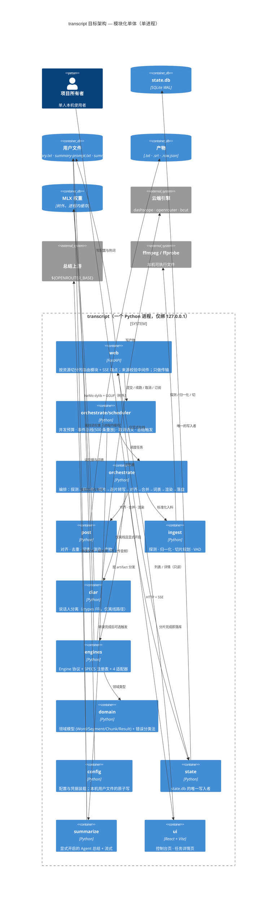

# 目标架构 — transcript（模块化单体）

**日期**：2026-10-17（v2 —— 已并入架构评审意见）
**依据**：`AI_NATIVE_SPEC.md`（C1–C9、NFR-1..12、行为契约）、`MODERNIZATION_BRIEF.md`（六阶段与绑定 criteria）、`topology.json`、`ASSESSMENT.md`
**目标形态**：`INTENT.md` 定的**模块化单体** —— 单进程、仅绑 `127.0.0.1`、模型在进程内缓存

> **v2 相对 v1 的实质改动**（均由评审指出并经源码核实）：`diar` 从「无归属」变成有独立包且明确**仅离线可用**；`config` 从 `contracts` 拆出（v1 声称「零 I/O」是假的）；无环性从口头断言变成 lint 强制；**砍掉 `engines → post` 与 `engines → ingest` 两条边**；`JobManager` 的调度职责从 `web` 移到 `orchestrate`；Phase 1 的脚手架从「搬 5 个纯函数」改为**一条可执行的纵向切片**；修正 4 处与源码不符的断言。

---

## 0. 一句话

这不是推平重来，是**保域换壳**：领域层已经具备模块化单体该有的形状，**搬运并加固**；Web 层与前端两层壳**按新边界重写**。

**「服务」在本架构里指模块包，不是部署单元。** 全部跑在一个进程里 —— 这是刻意的：离线模型（Qwen3-ASR + whisper-large-v3-turbo）在**进程内缓存**，跨进程不共享；拆进程会让离线路径每次冷启动重载权重。

---

## 1. C4 Container



---

## 2. 模块边界与归属理由

| 包 | 承载的旧模块 | 归属理由（哪条规则、哪个实体住在这里） | 承载的 NFR / 技术债 |
|---|---|---|---|
| **`domain/`** | `models.py` `errors.py` | 全系统的公共词汇。**已核实为零 I/O、零第三方依赖**：`errors.py` 除 `from __future__ import annotations` 外无 import；`models.py` 只用 `math`/`dataclasses`/`pathlib`。`RecoverableError` vs `FatalError` **就是**重试策略（`RULE-059`），不是描述性标签 | NFR-11 的分类语义 |
| **`config/`** | `config.py` | **从 `domain` 拆出**（v1 把它和 models/errors 放一起，使「零 I/O」这句话变成假的）。这里做文件 I/O：读 `config.env` + 旧版 `summary-settings.json`（`config.py:170-187`），写凭据并 `chmod`。配置优先级（`config.env` > 旧版设置 > 内建默认）是 `RULE-105` 的载体 | NFR-4 凭据只从文件读；技术债 #7（三份写入实现收敛为一） |
| **`ingest/`** | `audio.py` `vad.py` `chunking.py` | 只回答「音频是什么、该切成哪几片」。`chunking` 是纯函数，承载 C1 的物理不变量 `duration <= max_s`（`RULE-011`/`012`）——这条决定 300s 上游上限不被击穿。`audio` 是唯一碰 ffmpeg 的地方 | NFR-2 原文件只读；NFR-9 探测/归一化 |
| **`post/`** | `align.py` `merge.py` `glossary.py` `render.py` | 只作用于「已经拿到的文本与时间轴」。**P0-1 规则住在 `merge`** —— 它只关心分片边界，不关心分片怎么来。**`align` 住在 `post` 而非 `engines`**（v1 放错了，见 §2b） | 技术债 #10 常量集中 |
| **`engines/`** | `engines/base.py` + 4 适配器 | 可替换性靠**一张注册表**：引擎 id、凭据、`max_chunk_s`、成本文案全部派生自 `SPECS`。`RULE-108`/`111`/`113`/`114` 的载体 | NFR-5 在线必须显式；NFR-9 各引擎超时；技术债 #10 单价 |
| **`diar/`** | `diar.py` | **v1 漏了它。** 独立成包而不是并入 `post`：它是 ctypes FFI 绑定到带构建哈希的第三方 dylib（`diar.py:21-30` 硬编码 `…/NeMoSpeech/main-97a15af/…`），这个耦合值得在结构上显露。**⚠️ 仅离线路径可用** —— 见 §2a | C8；技术债 #9 |
| **`state/`** | `store.py` | **`state.db` 的唯一写入者**。旧系统有 **4 个模块**直接调用 Store 的写方法（`pipeline` `summary` `web/jobs` `web/app`）—— 全仓唯一的 `sqlite3.connect` 在 `store.py:159`。收敛靠 **lint 强制**（§3），不靠调用方的纪律 | 分片级检查点 = 续跑语义 |
| **`orchestrate/`** | `pipeline.py` + **`scheduler`（新）** | **编排脊柱**。C2 四条硬规则与 **P0-2 规则**住这里，它是唯一同时看得见分片状态与落盘决策的地方。**产物选择必须是单点决策**（旧系统是两次独立 `_write`，`artifact` 只把关一半）。`scheduler` 承载并发预算、事件总线与取消语义 —— 这些**不是传输层的东西** | NFR-3 错误不当结果；NFR-8/NFR-10 并发预算；技术债 #1 |
| **`summarize/`** | `summary.py` | 与转录**完全解耦**的独立状态机（C7）：转录不因总结失败而失败，总结只发文本不发音频。独立成包让「C7 是 P1」在结构上可见 —— 可整体丢弃而不动主链路 | NFR-8 批 24 000 字符/上限字段；NFR-9 总结 180s |
| **`web/`** | `web/app.py` `web/frontend.py` + **`jobs.py` 拆走调度部分** | **重写**。旧层是单个 635 行闭包、25 条路由、零可测接缝。新层**只做传输**：路由 + 请求校验 + SSE 转发。`frontend.py`（构建门禁）语义保留 | NFR-6 来源校验（新增）；NFR-7 构建硬门槛；技术债 #2 #6 |
| **`ui/`** | `frontend/` | **重写**。策略**已定**（见 §3），不再留成开放问题 | NFR-12 无远程依赖；技术债 #5 |
| **`cli.py`** | `cli.py` | 保留四个子命令；**改为经 `scheduler` 提交**（旧 CLI 在 `cli.py:80` 直接构造 `Pipeline`，绕开了 `JobManager`，所以 C9「CLI 与网页走同一条路」在 legacy 里并不成立） | C9 |

### 2a. `diar` 的两个必须写明的边界

1. **仅离线**：legacy 只在 `mode == "offline"` 时才做分离（`pipeline.py:331`：`if self.config.enable_diar and mode == "offline" and merged.segments`）。在线引擎返回的 `Segment` 里 `speaker` 恒为 `None`。
2. 因此 **C8「接通端到端」实际只对离线路径成立**。`MODERNIZATION_BRIEF.md` 的 Phase 3 判据应当同步收窄为「离线路径端到端」，或者由人明确裁定要否推翻这条限制。**这是 Phase 3 之前必须闭合的决策点**，已记入 §6。

### 2b. v1 的两条依赖边被砍掉

| v1 的边 | 为什么错 | v2 的做法 |
|---|---|---|
| `engines → post(align)` | 「对齐属于引擎适配」是合理化。`build_segments` 的两个调用点（`dashscope.py:118`、`offline.py:104`）拿到的是普通 `Word` 列表，与具体引擎无关；单调时间不变量是 `post` 的性质 | 引擎返回**原始 words**，由 `orchestrate` 调 `align` |
| `engines → ingest(audio)` | `dashscope.py:77` 调 `audio.probe(path).duration` 只为本地拦超长。而 `pipeline.py:189` **早就 probe 过一次**了 | `Engine.transcribe` 增加**已知时长/AudioInfo 入参**；超长拦截仍在引擎内，但数据是传入的 |

两条边消失后，依赖图成为真正分层：

```
domain  ←  config  ←  { ingest, engines, post, diar, state }  ←  orchestrate  ←  web
                                                                    ↑
                                                              summarize
```

**代价**：改 `Engine` Protocol 与两个调用点，动到 `test_engines_online.py` 的若干断言。**收益**：`engines` 真的只依赖 `domain`，下面的 lint contract 才能写强。

---

## 3. 技术选型与强制机制

| 选择 | 理由 |
|---|---|
| **Python 3.12**（不变） | `requires-python = ">=3.12,<3.13"` 是硬钉；`mlx-audio`/`mlx-whisper` 是 Apple Silicon 专属，换版本无收益且要重验全部 MLX 行为 |
| **FastAPI + uvicorn**（不变） | 已有 25 条路由契约与 SSE，重写的是组织方式而非框架；依赖注入正好是「依赖显式注入」这条边界的现成工具 |
| **SQLite（WAL）**（不变） | 单人本机；分片级检查点是续跑语义的载体 |
| **Pydantic 2**（仅 HTTP 边界） | 业务层的重复契约**必须合并**：`SummaryContent` 模型从未被实例化，校验是手写 `[:80]`/`[:2000]` 截断 —— 同一契约两处实现 |
| **`import-linter`（新增，dev）** | **无环性从口号变成可检查事实。** 用 `[tool.importlinter]` 声明 `domain ← config ← {ingest,engines,post,diar,state} ← orchestrate ← web` 的分层 contract，并在 pytest 里加一条断言。约 20 行配置。没有它，「哪一层可以依赖哪一层」在 Phase 4 遇到「我需要一个常量」那天就会失效 |
| **结构化日志（新增）** | 旧 `src/` 里 `import logging` 命中数为 **0**；失败只有一行插值异常文本，无关联 id、无落盘。P6 必须补上。日志接口归 `orchestrate/scheduler`（任务关联 id 在那里） |
| **React + Vite + Tailwind**（不变），**策略已写死** | 旧系统同时存在手写 `fetch`、手写 `popstate` 路由、`useState`，以及三个**已安装但零引用**的依赖（`react-router-dom`、`@tanstack/react-query`、`zustand`，`frontend/src` 命中数 0）。**决定**：保持无前端路由、每页一个状态根、`fetch` 封装在 `lib/api.ts`；**删除**三个未用依赖与 9 个未用 shadcn 组件。与现有信息架构一致，零行为迁移 |
| **可调常量集中到注册表旁**（技术债 #10） | `engines/base.py:76-104` 已证明这个模式好用。要集中的：`ONLINE_PRICE_PER_HOUR`（`pipeline.py:37`，用户可见成本估算的常量）、`DEFAULT_PORT`（`cli.py:25`）、`MAX_UPLOAD_BYTES`（`web/app.py:52`，只在 `:275` 一处生效）、产物选项。**并删掉重复的真相来源**：`estimate_cost`（`pipeline.py:92-106`）把 `auto → artifact` 映射又实现了一遍，真相来源是 `engines/base.py:109` 的 `AUTO_BY_ARTIFACT` |

### 明确不做
不加鉴权（单人本机）、**不拆进程**（模型进程内缓存，NFR-1）、不引消息队列、不引 ORM、不引额外的前端状态库。

### 一条有意改变 legacy 行为并署名
**bcut 的 90s 风控冷却从实例状态提到进程级。** 现状：`_banned_until` 是实例属性（`bcut.py:70`），而每个任务新建一个引擎实例（`pipeline.py:194`）—— 两个 bcut 任务能各自去撞正在风控的上游，冷却形同虚设。**这是真 bug，不是风格问题**；修它意味着行为变更，按 `MODERNIZATION_BRIEF.md` 的门禁**署名记录**。

---

## 4. 数据迁移

| 数据 | 现状 | 方案 |
|---|---|---|
| **`state.db`** | 11 个任务 / 469 个分片的真实历史；三张表 | **保留库，只改代码。** schema 不变；`state/` 成为唯一写入者后读写路径收敛。**不重建库** —— 历史任务的续跑能力是产品承诺 |
| **`config.env`** | 0600 文件（**目录权限源码里没有 `0o700`，v1 那条是文档假设**）；引擎密钥 + 总结模型 + Base URL | **不动格式。** 写路径从三份实现收敛到一个原子写辅助函数（临时文件 + `os.replace` + 0600 + 保留用户注释）。以 `config.save_credentials`（无人调用但实现正确的那份）为规格 |
| **`summary-settings.json`** | **v1 漏了。** 旧版兼容输入：`SUMMARY_MODEL` 缺失或提示词文件不存在时读它（`config.py:170-187`），读不出来还会抛 `ValueError` | **Phase 2 必须明确**：保留读取，还是删掉兼容分支。保留则配置优先级契约要多一个分支测试；删除则要署名一个行为变更 |
| **`glossary.txt`** | 0600；规则 + 裸热词 + 注释 | **不动格式。** 写入改成原子替换（旧实现是裸 `write_text`，崩溃会截断词表）。`# 注释` 与 `错词 -> 正确词` 语法不变（`RULE-060`） |
| **`summary-prompt.txt`** | 0600，已是原子写 | 不动 |
| **产物 `.txt`/`.srt`/`.raw.json`** | 落在处理源文件旁边 | **不动位置。** `.raw.json` 结构是下游消费契约（`RULE-132` 要求保留替换前原文），Phase 5 需逐字段等价 |
| **MLX 权重** | 树外，首次使用时加载 | 不动 |
| **`uploads/`** | 浏览器副本，无清理 | 保留路径；P6 删除 `/api/upload` 后补清理策略 |

**回滚姿态**：`legacy/transcript/` 冻结且全程不改，`state.db` 原地保留 —— 任何时候都能用旧代码重新接管同一份数据。这是选「保留库」的主要理由。

---

## 5. Phase 1 的落地：一条可执行的纵向切片

方案书把 Phase 1 绑定为 5 个模块（`models` `errors` `chunking` `glossary` `render`），首批切片 `chunking` + `render`。
**v1 的做法有缺陷**：这 5 个模块全是纯函数、零副作用、已有现成测试，只搬它们等于「建 3 个目录 + 复制 5 个纯函数 + 重写已存在的测试」——**一条真实接缝都碰不到**（不碰 `config` 的文件 I/O、不碰 `engines` 的注册表、不碰 SQLite、不碰 `create_app` 的路由）。那样产出的 `PLAYBOOK.md` 会是关于复制粘贴的证据，而不是方案书自己要求的「重写一个模块的标准动作」的证据。

**v2 的做法**：建同样的 3 个包，但**用一次真实的 `run` 把它们串起来**，让试点撞上文件 I/O、import 图与产物落盘。

| 待建服务 | 承载的 Phase 1 模块 | 承载的规则 | 该包在本阶段只含 |
|---|---|---|---|
| **`domain/`** | `models` `errors` | `RULE-025`（时间戳格式与取整）、`RULE-059`（HTTP 失败分类） | 全部（两个文件） |
| **`config/`** | `config`（**v1 漏在包外，但它是真实接缝**） | `RULE-105`（配置优先级与旧版兼容） | 只读路径 + `load`；**不**动写路径（属 Phase 2） |
| **`post/`** | `glossary` `render` | `RULE-021` `022` `060` `132`、`RULE-062` `135` `136` | 只 `glossary.py` + `render.py`；`align` `merge` 属 Phase 3 |
| **`ingest/`** | `chunking` | `RULE-011` `012` | 只 `chunking.py`；`audio` `vad` 属 Phase 3 |
| **`run` 入口（新）** | — | — | 一个最小 CLI：读一段真实音频的**元数据**（时长 + 语音区间）与前一片文本 → 走 `chunking` → `glossary` → `render` → 写真实的 `.txt`/`.srt`/`.raw.json` 到磁盘。**这是让试点碰到接缝的那一步** |

**不在 Phase 1**：`audio`/`vad`（P3）、`align`/`merge`（P3）、`engines`（P4）、`store`（P2）、`diar`（P3）、`orchestrate` 完整形态与 `scheduler`（P5）、`web`/`ui`（P6）。**架构完整但不一次建完** —— 试点要小而完整，不是先把全部包摆出来。

> **给方案书的 `Proposed revision:`**：Phase 1 的 `Modules` 从 5 个模块扩为「5 个模块 + `config` 的只读部分 + 一个 `run` 入口」。理由见上。批准者若不改，Phase 1 就按原样搬 5 个纯函数执行 —— 本架构文档的其余部分不受影响。

---

## 6. 架构层面承接的安全前置项（P6，此处先记）

| 项 | 要求 | 依据 |
|---|---|---|
| **来源校验中间件** | 拒绝 `Host` 非 `127.0.0.1[:port]`/`localhost[:port]`；所有非 GET 路由要求 `Sec-Fetch-Site: same-origin`（或 `Origin` 白名单） | NFR-6；评估里唯一的实质安全风险 |
| **`/api/upload`** | 删除（人裁定 Q11） | 未认证、无上限的写入路径 |
| **`/api/reveal`** | 保留，但纳入同一来源校验（人裁定追加项） | 否则是「让任意网页打开任意路径」的原语 |
| **SSRF 收敛** | `OPENROUTER_BASE` 解析后拒绝回环/私有/link-local；主机变更时要求重新输入密钥 | 评估 CWE-918 |
| **参数注入** | ffmpeg/ffprobe 的位置参数前加 `--` | 评估 CWE-88（当前不可达，CLI 入口可传相对名） |
| **C5/C9/NFR-8/NFR-9/NFR-10 的归属** | 事件扇出与 500 条重放、并发预算、心跳与取消语义 → `orchestrate/scheduler`；各引擎超时 → `engines`；容量上限 → 各自边界 | 见 §2 表的最后一列 |

**这些不在 Phase 1 范围内** —— 记在这里是为了让它们在架构图上有位置，避免 P6 重新发现。

---

## 7. 决定点 —— **Checkpoint 2 已全部裁定（2026-10-17）**

| # | 决定 | 裁定 | 落点 |
|---|---|---|---|
| 1 | **C8 的离线限制**（§2a） | **接受「仅离线」**。不去推翻它 —— 让在线路径也输出 speaker 需要在线引擎产出说话人信息，而四个引擎里没有一个提供；那会变成**新增能力**而非重建，与「重建不加功能」的初衷相冲。收窄为：离线路径端到端接通；在线路径 `speaker` 保持 `None`，并有测试断言（免得以后有人误以为在线也支持） | 已写入方案书 Phase 3 的 `Proposed revision` |
| 2 | **Phase 1 改纵向切片**（§5） | **改**。三个包 + 一个最小 `run` 入口，碰真实文件 I/O 与产物落盘。**但不含 `config`、不含 `store`** —— 加 `config` 会把 Phase 2 的范围提前，而 RULE-105 的修复绑定在 Phase 2，若 Phase 1 就引入它就得按「逐字节等价」重现它的缺陷行为，白做一遍 | 已写入方案书 Phase 1 的 `Proposed revision` |
| 3 | **`summary-settings.json`** | **保留读取**（Phase 2 执行时再定实现细节），并补配置优先级的分支测试。删除等于一个要署名的行为变更，而它保护的是用户手上可能存在的旧文件 | Phase 2 |
| 4 | **`state.db` 现有 11 个任务** | **读**（保留库不重建）。这也是回滚姿态的基础 —— 任何时候都能用旧代码重新接管同一份数据 | Phase 2 |

### 7b. 一条贯穿始终的范围纪律（人的初衷）

本次是**重建，不是加功能**。`PRODUCT.md` 的非目标即承诺：实时听写、批量排队、翻译、说话人分离、字幕编辑器、云端/多用户、鉴权 —— 全部不做。C8 是**唯一**一处经人裁定放行的扩展，且其边界就是「把已经写好的 `diar.py` 接通」，到此为止（见决定 1）。

因此脚手架阶段**不得**出现：新的引擎、新的路由（除既有的）、新的前端页面、新的依赖（除 `import-linter` 这个 dev 依赖）。每一处超出 `AI_NATIVE_SPEC.md` 的能力清单的东西都需要先回到规格。

---

## 附：被修正的 4 处与源码不符的断言（v1 → v2）

| v1 的说法 | 实际 | v2 的写法 |
|---|---|---|
| 「MLX 模型在 lifespan 内常驻」 | **不对**。`src/` 里没有 lifespan / startup 钩子 / 预热；`_load_qwen` 是首次调用才加载的模块级全局（`offline.py:21-35`），VAD 同理（`vad.py:17-28`）。4GB 常驻是**跑起来之后**的性质 | 「模型在**进程内缓存**，跨进程不共享；因此保持单进程」。照 v1 的措辞会有人去加启动预加载，那会破坏 `check`/`run` 这条不启服务的路径（`cli.py:64-103`） |
| 「`config.env` 位于 0700 目录」 | 源码里没有 `0o700`（只有文件级 `chmod 0o600`，`config.py:244`；`mkdir` 不带 mode） | 删掉目录权限的断言 —— 那是文档假设不是实现事实 |
| 「5 个写入方绕过仓储」 | **4 个模块**调用 Store 的写方法（`pipeline` `summary` `web/jobs` `web/app`），且全仓唯一的 `sqlite3.connect` 在 `store.py:159` | 按证据写 4 个 |
| 「注册表是单一真相来源，因此没有调用点硬编码引擎知识」 | **被代码反驳**：`estimate_cost`（`pipeline.py:92-106`）重复实现了 `auto → artifact` 映射（真相来源是 `base.py:109`），`pipeline.py:37` 硬编码单价 | 保留「注册表是真相来源」这个**目标**，并明确列出要消除的两处重复（§3） |